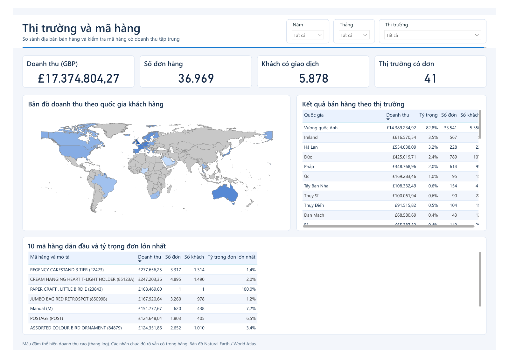

# Online Retail Intelligence

**Phạm Thanh Phúc** · Đồ án chuyên ngành Hệ thống thông tin, HUTECH

Tôi dùng dữ liệu hóa đơn của một nhà bán lẻ trực tuyến tại Anh để trả lời ba câu hỏi của bộ phận bán hàng. Khi nào cần chuẩn bị cho cao điểm? Mã hàng nào có nhu cầu ổn định? Nên ưu tiên chăm sóc lại nhóm khách nào?

## Bài toán tôi đặt ra

Trong hai tháng 10–11, tổng doanh thu năm 2011 gần như đi ngang so với năm 2010. Khi tách theo quốc gia, doanh thu ở Vương quốc Anh giảm **3,1%**, còn các thị trường ngoài Anh cộng lại tăng **14,3%**. Nếu chỉ nhìn tổng doanh thu, bộ phận bán hàng dễ bỏ qua sự dịch chuyển này khi chuẩn bị hàng cho mùa cao điểm.

Tôi dùng giao dịch lịch sử để mô phỏng cách bộ phận bán hàng và vận hành đọc báo cáo, kiểm tra số liệu rồi chọn việc cần làm tiếp. Bối cảnh sử dụng là giả định của đồ án.

## Phần tôi thực hiện

| Năng lực | Tôi đã làm gì | Minh chứng |
| --- | --- | --- |
| **Business Analysis** | Chuyển câu hỏi kinh doanh thành yêu cầu cho từng trang, chốt cách tính KPI với các tình huống dễ hiểu sai và viết tiêu chí nghiệm thu có số đối chiếu. | [BRD/SRS](docs/business_requirements.md) · [Use case Power BI](docs/use_cases.md) |
| **Data Analysis** | Gộp hai sheet Excel bằng pandas, ghi lại số dòng qua từng bước lọc, dựng mô hình sao và KPI trong Power BI. Kiểm tra đơn bất thường và đo tỷ lệ mua lại của từng nhóm RFM trên giao dịch phát sinh sau kỳ chấm điểm. | [Phân tích và đề xuất](docs/business_strategy.md) · [Đối soát số liệu](docs/validation.md) |

## Báo cáo Power BI

[Xem ảnh của cả ba trang](demo/README.md) · [Tải file Power BI (.pbix)](demo/Online%20Retail%20Intelligence%20-%20Ban%20hang%20VI.pbix)

| Trang | Câu hỏi báo cáo giúp trả lời |
| --- | --- |
| **Tổng quan bán hàng** | Doanh thu, đơn hàng và khách thay đổi ra sao theo tháng và ngày? Nếu kỳ hiện tại thiếu ngày, chênh lệch thế nào khi so với cùng số ngày năm trước? |
| **Khách hàng** | Khách mua lần đầu trong dữ liệu hay khách từng mua đóng góp nhiều hơn? Nhóm nào nên ưu tiên giữ chân hoặc thử chăm sóc lại? |
| **Thị trường và mã hàng** | Doanh thu tập trung ở quốc gia nào? Một mã hàng đứng đầu nhờ nhiều khách mua hay nhờ một hóa đơn lớn? |



[Xem trang Tổng quan bán hàng](demo/images/tong-quan-ban-hang.png) · [Xem trang Khách hàng](demo/images/phan-tich-khach-hang.png)

## Một ví dụ từ dữ liệu

Mã `22423` đạt **£277.656** qua **3.317 đơn**. Mã `23843` đạt **£168.470** từ **một đơn**. Trong Excel có một dòng hủy khớp mã khách, mã hàng, đơn giá và số lượng đối dấu sau đó 12 phút. Tôi sẽ đưa `22423` vào danh sách theo dõi trước mùa cao điểm và đối soát đơn của `23843` trước khi dùng số liệu để đề xuất nhập thêm hàng. [Phép đối chiếu và cách chạy lại](docs/business_strategy.md)

Sau khi gộp và làm sạch **1.067.371 dòng**, còn **779.425 dòng**, tương ứng **£17,37 triệu doanh thu**, **36.969 đơn** và **5.878 khách có mã định danh**. Doanh thu tính trên các dòng bán dương đủ điều kiện, theo GBP.

## Chạy lại dự án

1. Tải [Online Retail II từ UCI](https://archive.ics.uci.edu/dataset/502/online+retail+ii), giải nén `online_retail_II.xlsx` vào `data/raw/`.
2. Chạy từ thư mục gốc bằng Python 3.11 hoặc 3.12.

   ```sh
   python -m pip install -r requirements.txt
   python -m unittest discover -s tests -v
   python src/pipeline.py
   python -m src.strategy
   ```

3. Mở [Online Retail Intelligence.pbip](powerbi/Online%20Retail%20Intelligence.pbip) bằng Power BI Desktop. Đặt `pDataFolder` thành đường dẫn tuyệt đối tới `data/processed` rồi làm mới dữ liệu. [Hướng dẫn mở báo cáo](powerbi/BUILD.md)

Bản PBIP trong repo có hai trang và chứa mô hình dữ liệu, Power Query và các phép đo DAX. Bản Power BI tiếng Việt ba trang trong thư mục demo có sẵn dữ liệu và được mô tả trong BRD/SRS và use case.

[Báo cáo đồ án và những thay đổi khi dựng lại](docs/case_study.md) · [Mô hình và từ điển dữ liệu](docs/data_model.md) · [Notebook khảo sát dữ liệu](notebooks/retail_analysis.ipynb)

**Nguồn dữ liệu** Daqing Chen, *Online Retail II*, UCI Machine Learning Repository. [DOI](https://doi.org/10.24432/C5CG6D) · [CC BY 4.0](https://creativecommons.org/licenses/by/4.0/)

**Bản đồ** Dữ liệu hình học từ Natural Earth, đóng gói bởi [World Atlas](https://github.com/topojson/world-atlas).
