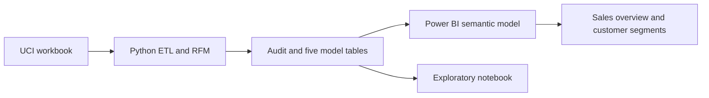

# Online Retail Intelligence

A Power BI and Python reconstruction of the online retail analytics project I completed as an Information Systems student at HUTECH. V2 turns the UCI workbook into a reproducible sales report and an RFM customer snapshot.

**Student** Phạm Thanh Phúc

## Report


- **Sales overview** tracks revenue, distinct orders, active customers and average order value. It shows monthly revenue and the leading customer markets and stock codes.
- **Customer segments** compares active customers and sales by RFM group and ranks customers by sales in the selected slice.
- Both pages support year and market filters. RFM assignments use the full-period snapshot on 10 December 2011.

## Verified results

| Metric | Full period |
| --- | ---: |
| Workbook rows | 1,067,371 |
| Qualifying transaction lines | 779,425 |
| Sales revenue | £17,374,804.27 |
| Distinct orders | 36,969 |
| Active customers | 5,878 |
| Average order value | £469.98 |

The UK accounted for **82.8%** of qualifying sales. November 2010 was the highest month at **£1.17M**, closely followed by November 2011. December 2011 covers days 1–9. The High Value group accounted for **28.6% of customers and 80.2% of sales**. Monetary value contributes to RFM scoring, so the sales concentration describes this grouping by design.

Revenue covers positive sales from identifiable customers after cleaning. Market comes from customer country of residence. The sales data includes non-merchandise stock codes such as postage and manual charges.

## Reproduce

1. Download [Online Retail II](https://archive.ics.uci.edu/dataset/502/online+retail+ii). Extract `online_retail_II.xlsx` to `data/raw/`.
2. From the repository root with Python 3.11 or 3.12, run:

   ```sh
   python -m pip install -r requirements.txt
   python -m unittest discover -s tests -v
   python src/pipeline.py
   ```

3. Open [Online Retail Intelligence.pbip](powerbi/Online%20Retail%20Intelligence.pbip) in Power BI Desktop. Set `pDataFolder` to the absolute path to `data/processed` and refresh. Follow the [Power BI guide](powerbi/BUILD.md) for the menu steps.



## Documentation

- [Case study based on the original academic report (Vietnamese)](docs/case_study.md)
- [Power BI use cases with worked examples (Vietnamese)](docs/use_cases.md)
- [Business decisions informed by the dashboard (Vietnamese)](docs/business_strategy.md)
- [Business questions and cleaning rules](docs/business_requirements.md)
- [Data dictionary and star schema](docs/data_model.md)
- [KPI definitions and validation evidence](docs/validation.md)
- [Reconstruction notes](docs/recovery_notes.md)
- [Exploratory notebook](notebooks/retail_analysis.ipynb)

The original academic report used Colab and Power BI Service. The V2 source uses a local Python batch pipeline and Power BI Desktop. The raw workbook, generated CSVs and Desktop cache are local artifacts. The repository tracks the report layout, Power Query definitions, semantic model and DAX measures as text.

Dataset attribution: Daqing Chen, *Online Retail II*, UCI Machine Learning Repository, [DOI 10.24432/C5CG6D](https://doi.org/10.24432/C5CG6D), [CC BY 4.0](https://creativecommons.org/licenses/by/4.0/). The pipeline transforms the source data into model tables.
