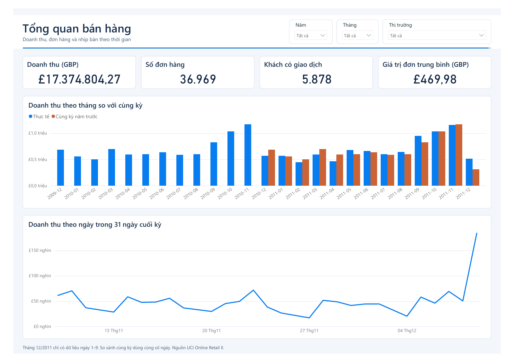
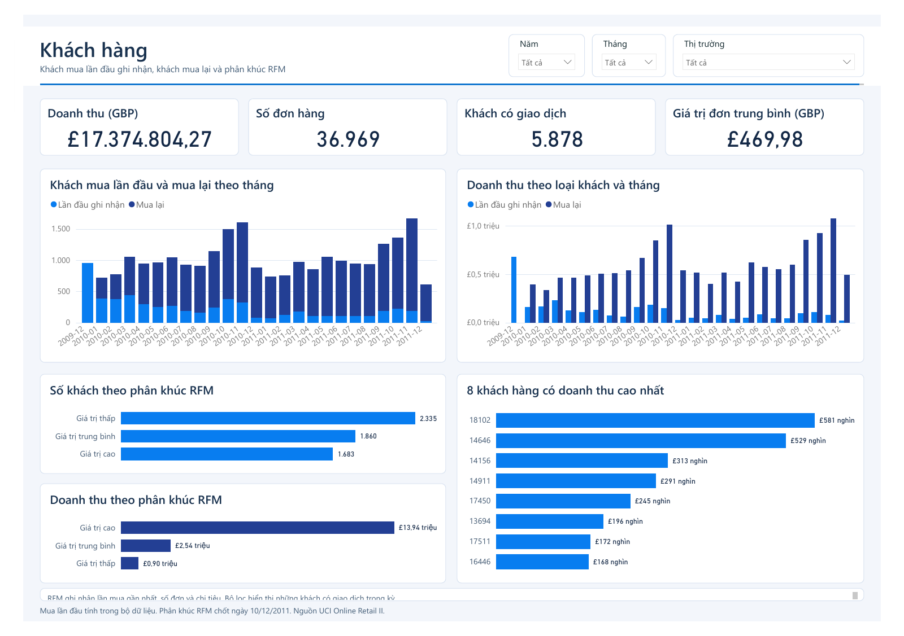
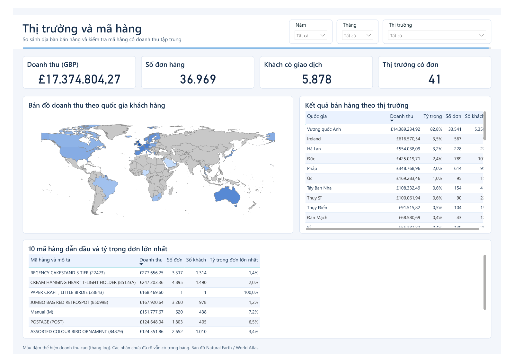

# Demo Power BI

[Xem hoặc tải file Power BI (.pbix)](Online%20Retail%20Intelligence%20-%20Ban%20hang%20VI.pbix)

File PBIX có dữ liệu giao dịch đã nạp sẵn để mở và tương tác trong Power BI Desktop. Ba ảnh bên dưới cho phép xem toàn bộ bố cục ngay trên GitHub.

## Tổng quan bán hàng

Doanh thu, số đơn, số khách có giao dịch và giá trị đơn trung bình. Biểu đồ so sánh doanh thu theo tháng với cùng kỳ và hiển thị nhịp bán theo ngày.

## Khách hàng

Số khách và doanh thu theo tháng của nhóm mua lần đầu và mua lại, phân khúc RFM và tám khách có doanh thu cao nhất.

## Thị trường và mã hàng

Bản đồ doanh thu theo quốc gia của khách hàng và bảng xếp hạng mã hàng kèm tỷ trọng doanh thu từ hóa đơn lớn nhất.

