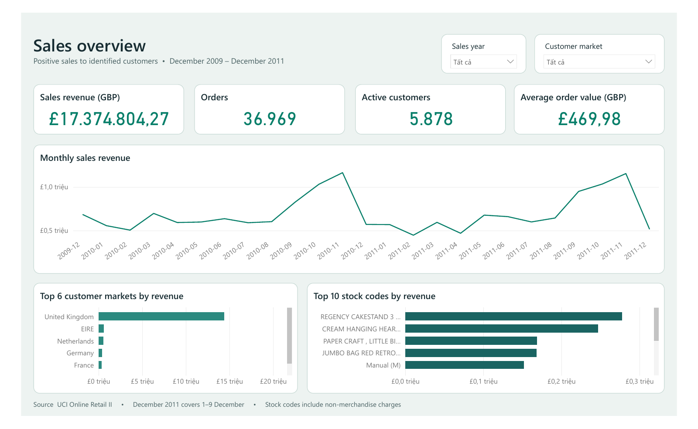

# Phân tích doanh thu bán lẻ trực tuyến

Đây là đồ án nhóm môn Phân tích dữ liệu trên điện toán đám mây tại HUTECH. Nhóm dùng bộ Online Retail II của UCI, ghi lại các giao dịch của một nhà bán lẻ trực tuyến tại Anh từ tháng 12/2009 đến tháng 12/2011. Từ các dòng hóa đơn trong Excel, nhóm muốn biết tháng nào bán được nhiều, mặt hàng nào đóng góp nhiều doanh thu và khách hàng có thói quen mua ra sao.

## Nhóm đã làm gì trong đồ án

Nhóm lưu Excel trên Google Drive và đọc dữ liệu bằng pandas trong Colab. Một hóa đơn có thể có nhiều dòng hàng, nên nhóm tính doanh thu từng dòng bằng số lượng nhân đơn giá và đếm đơn theo mã hóa đơn. Các hóa đơn bắt đầu bằng `C` bị loại. Dòng thiếu mã khách hoặc mô tả cũng bị loại để có thể dùng cùng tập dữ liệu cho phân tích sản phẩm và khách hàng.

Nhóm dùng Colab để kiểm tra dữ liệu và vẽ thử biểu đồ, sau đó dựng dashboard trong Power BI Desktop và đưa lên Power BI Service để trình bày. Bốn chỉ số doanh thu, đơn hàng, khách hàng và giá trị đơn trung bình nằm ở đầu trang. Bên dưới là doanh thu theo tháng, xếp hạng sản phẩm và khách hàng, cùng biểu đồ phân khúc RFM. Khi so sánh Colab với Power BI, báo cáo lấy ví dụ xem doanh thu tháng 10 ở Đức. Người xem chọn thị trường Đức rồi đọc điểm tháng 10 trên biểu đồ, trong khi các biểu đồ khác cũng đổi theo thị trường đã chọn.

## Kết quả ghi trong báo cáo đồ án

Mục 6.2 ghi nhận khoảng **£8,83 triệu doanh thu**, **19.000 đơn**, **4.000 khách hàng** và giá trị đơn trung bình **£460**. Trong phần phân khúc, nhóm so sánh khách hàng theo thời gian kể từ lần mua gần nhất, số lần mua và tổng chi tiêu. Theo cách chấm điểm được sử dụng khi đó, nhóm Low Value chiếm tỷ trọng lớn nhất. Ba chỉ số này mô tả lịch sử mua hàng trong tập dữ liệu.

## Khi dựng lại báo cáo

Đoạn mã Colab còn lưu gọi `read_excel` mà không chỉ định sheet. Chạy lại các bước lọc trong đoạn mã đó trên sheet đầu cho doanh thu **£8,832 triệu**, gần với mức ghi trong đồ án. File Excel có hai sheet chồng lấn ở tháng 12/2010. Bản trong repo đọc cả hai, gộp dữ liệu và loại các dòng trùng khớp hoàn toàn sau chuẩn hóa.

Sau làm sạch còn **779.425 dòng**, tương ứng **£17,37 triệu doanh thu**, **36.969 đơn** và **5.878 khách hàng**. Phần địa lý dùng quốc gia của khách hàng, nên Vương quốc Anh được đọc như một thị trường. Hai tháng có doanh thu cao nhất là tháng 11/2010 và tháng 11/2011. Khi đọc điểm cuối trên biểu đồ, cần nhớ dữ liệu tháng 12/2011 dừng ở ngày 9.

Các tình huống xem báo cáo được ghi trong [use case Power BI](use_cases.md). Số liệu theo từng phạm vi và từng bước lọc nằm trong [tài liệu đối soát](validation.md).

*Nguồn nội dung đồ án gồm câu hỏi phân tích ở mục 1.4, luồng xử lý ở mục 4.4, phần làm sạch và làm giàu dữ liệu ở mục 5.2–5.3, và kết quả cùng dashboard ở mục 6.2–6.6.*
