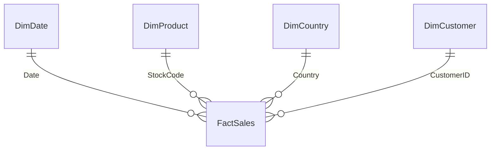

# Data dictionary and dimensional model

| Source field | Type | Business meaning | Target |
|---|---|---|---|
| Invoice | text | Invoice identifier; C prefix indicates cancellation | FactSales.InvoiceNo |
| StockCode | text | Product identifier | FactSales.StockCode / DimProduct.StockCode |
| Description | text | Product label; may vary by invoice | DimProduct.Description (latest observed label) |
| Quantity | numeric | Item quantity | FactSales.Quantity |
| InvoiceDate | datetime | Transaction timestamp | FactSales.InvoiceDate / Date |
| Price | decimal | Unit price, GBP | FactSales.UnitPrice |
| Customer ID | text | Customer identifier | FactSales.CustomerID / DimCustomer.CustomerID |
| Country | text | Customer country of residence | FactSales.Country / DimCountry.Country |

Power Query combines each stock code with its latest description for the report axis.

Derived fields include Revenue (quantity × price), Date (date only), YearMonth, Year, MonthNo, Quarter; RFM fields LastPurchase, Recency, Frequency, Monetary, RScore, FScore, MScore, RFMScore, Segment, SnapshotDate.

All four relationships are 1:* with single direction from dimension to fact. Fact grain: one retained normalized transaction line; no asserted unique invoice-level grain. DimDate has a contiguous date per row, DimProduct one SKU, DimCountry one country, DimCustomer one customer with a full-period RFM snapshot. No relationship between dimensions.
